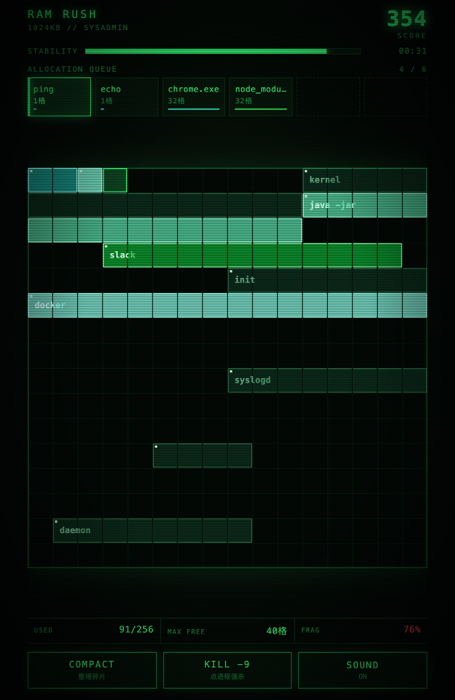
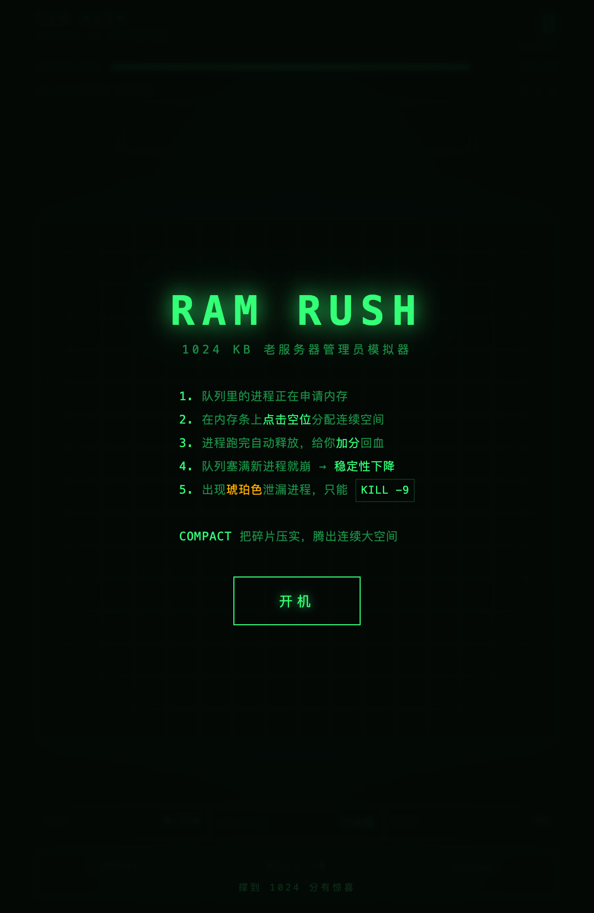
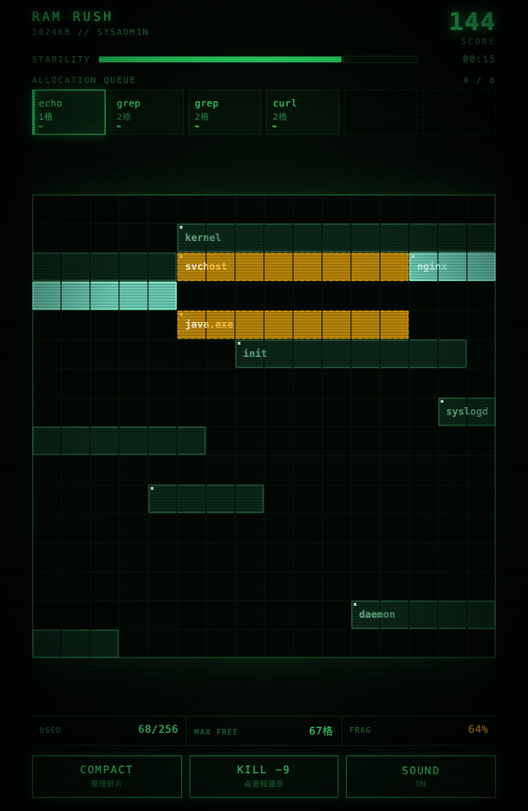
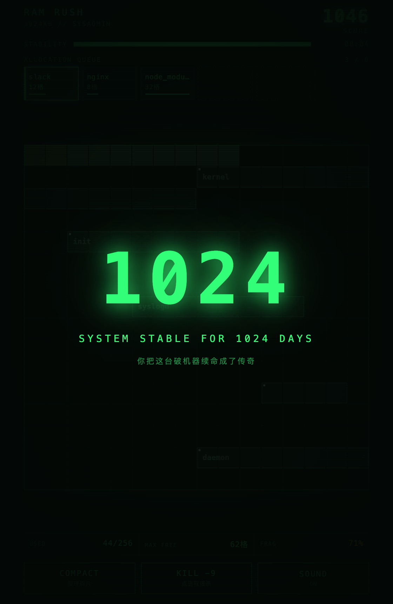
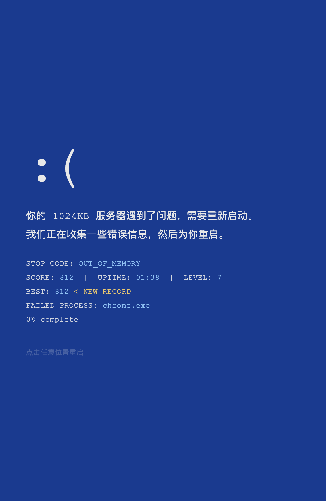

# RAM RUSH · 内存危机

> 你是一台只有 1024KB 内存的老服务器，chrome.exe 要 32 格，你只有 256 格。

一个关于内存分配的单文件网页游戏。16×16 共 256 格内存条，每格 4KB，加起来正好 1024KB。进程不断来申请内存，你把它塞进连续空位，跑完自动释放；碎片攒多了塞不下，队列一爆就是蓝屏。

**在线试玩**：https://ram-rush.app.workbuddy.host/?sharecode=WU6EESIT77



## 玩法

点击内存条上的连续空位，把队列里的进程放进去。进程跑完自动释放、加分并回复稳定性。队列只有 6 个槽，塞满之后新进程无处可去，稳定性持续下跌，跌到 0 就结束。

三个技能：

| 技能 | 作用 | 代价 |
| --- | --- | --- |
| `COMPACT` | 把所有进程压实到内存前端，挤出碎片 | 冷却 26 秒 |
| `KILL -9` | 点击内存条上的进程强杀 | 扣分，冷却 1.6 秒 |
| 内存泄漏 | 2 级起出现的琥珀色进程，永不释放 | 只能 `KILL -9` 处理 |

底部那条 `USED / MAX FREE / FRAG` 不是装饰：`MAX FREE` 小于你要放的进程尺寸，就说明该压实了。

撑到 1024 分会触发彩蛋 —— `SYSTEM STABLE FOR 1024 DAYS`。

## 截图

| 启动 | 运行中 |
| --- | --- |
|  |  |

| 泄漏进程 | 1024 彩蛋 | 蓝屏结算 |
| --- | --- | --- |
|  |  |  |

## 本地运行

没有构建步骤，也没有依赖：

```bash
git clone https://github.com/freshbin/ram-rush.git
cd ram-rush
open index.html          # macOS；Windows 用 start，Linux 用 xdg-open
```

或者起一个静态服务：

```bash
python3 -m http.server 8000
```

## 实现说明

- 单个 `index.html`，1587 行，零依赖：没有 CDN、没有图片文件、没有字体文件
- 内存条用 Canvas 2D 逐格绘制，进程块按 `hue 98–182` 加亮度分档区分，天真的相邻同色会糊成一片
- 音效用 Web Audio 现场合成（方波、锯齿波加指数衰减），一个音频文件都没有
- 尺寸用 `ResizeObserver` 算正方形边长，不依赖 `object-fit`，否则指针坐标会算错
- 最高分存 `localStorage`，蓝屏时显示 NEW RECORD

设计上让「1024」长在玩法里而不是贴在标题上：每格 4KB、总量 1024KB、1024 分触发彩蛋，三个数字都是同一个数。

## 已知取舍

- 难度曲线是凭手感调的，`CFG` 里的 `spawnBase`、`levelEvery`、`overflowDmg` 都在文件顶部，改一行就能变难
- 泄漏进程出现率调整过几轮，太高会让画面被琥珀色占满，绿磷光的调子就没了
- 没有排行榜，纯本地存档，不收集任何数据

## License

MIT
